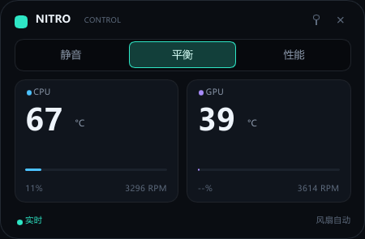

# Nitro Control

English | [简体中文](README.md)

A lightweight native control widget for Acer Nitro / Predator laptops. Slint + software renderer, a LocalSystem broker, and on-demand service startup. No WebView, no Electron, no kernel driver.

## Why

On this AN515-58, the original NitroSense 3.1.3056 uses about 144 MB of RAM and 90-95% of one CPU core while its monitoring page is open; even with the UI closed, about 69 MB stays resident.

Nitro Control keeps the original privilege split — a privileged Windows service plus a normal-user UI — but replaces the UI with a small Slint software-rendered widget and makes the service demand-start with idle shutdown.

## Measurements

AN515-58, i7-12650H, RTX 4050 Laptop, 125% DPI:

| Component | Working set | Private |
|---|---:|---:|
| nitro-widget (Slint software) | 18.9 MB | 3.8 MB |
| nitro-broker (WMI + NVML) | 39 MB | 27 MB |
| Total | about 58 MB | about 31 MB |

The service stops itself after 5 minutes without a client. Closing the widget leaves no background process.

## Features

- 360x236 frameless, always-on-top, draggable widget
- Thermal modes: Quiet / Balanced / Performance
- CPU: temperature, load, fan RPM
- GPU: temperature, load, fan RPM
- Non-elevated UI; on-demand service
- Chinese UI using system fonts

Not yet implemented: 4-zone RGB, fan-curve editor, tray icon, GPU overclocking, per-model capability tables. This release focuses on monitoring and mode switching.

## Architecture

    nitro-widget.exe  (normal user, Slint software)
            |
            |  \\.\pipe\nitro-control
            v
    NitroControlBroker  (Windows service, LocalSystem, start=demand)
            |
            v
    ACPI-WMI AcerGamingFunction + NVML + sysinfo

The UI starts the service through the Service Control Manager when it needs data. The service stops itself after 5 minutes with no client.

## Security

- Service installed under C:\Program Files\NitroControl; only SYSTEM/Administrators can modify it, Users can read/execute
- Pipe ACL allows only SYSTEM, Administrators, and the current user SID recorded at install time
- The service checks the full image path of the client; it must be nitro-widget.exe in the same directory
- Only telemetry and set_mode are accepted; modes are limited to 0/1/4/5/6
- 4 KB request limit, at most 8 pipe instances, 300 ms set_mode rate limit, remote clients rejected
- No arbitrary executable/path command, no shell, no network listener
- Logs and config in C:\ProgramData\NitroControl; user read-only

## Download and install

Download from Releases:

    https://github.com/Isilsolme/nitro-control/releases/latest

The installer:

1. Copies nitro-broker.exe / nitro-widget.exe to C:\Program Files\NitroControl
2. Tightens the directory ACL
3. Records the current user SID in C:\ProgramData\NitroControl\user.sid
4. Creates the LocalSystem service NitroControlBroker (start=demand) with a service DACL that lets the current user start it without UAC
5. Creates Start Menu and desktop shortcuts; the optional "Start widget at login" component is off by default

The installer does not launch the UI elevated. After installation, start Nitro Control from the Start Menu as a normal user.

## Build

Requirements: Rust (MSVC toolchain), Windows 10/11 x64:

    cargo build --release

## Build the installer

NSIS is required. Install it with winget, or use the NSIS bundle shipped with Tauri:

    winget install NSIS.NSIS
    powershell -ExecutionPolicy Bypass -File installer\build.ps1

Output:

    dist\NitroControl-Setup-0.1.1.exe

GitHub Actions builds the same installer on windows-latest with chocolatey NSIS.

## Service control

    sc.exe query NitroControlBroker
    sc.exe start NitroControlBroker
    sc.exe stop NitroControlBroker

The widget starts the service automatically. It stops after 5 minutes without a client and starts again on the next launch.

## Uninstall

Settings > Apps > Nitro Control, or run:

    "C:\Program Files\NitroControl\uninstall.exe"

The uninstaller stops/deletes the service and removes shortcuts, files and C:\ProgramData\NitroControl.

## Limitations

- Tested only on Acer Nitro AN515-58 (BIOS V2.21); WMI layouts may differ on other models
- Installer and binaries are unsigned; sign them before broad distribution to avoid SmartScreen warnings
- Installation requires administrator rights once
- Windows x64 only

## Layout

    core/       WMI, NVML, telemetry worker
    broker/     Windows service, named pipe, security checks
    widget/     Slint UI + pipe client
    installer/  NSIS installer
    .github/    GitHub Actions

Logs:

    C:\ProgramData\NitroControl\broker.log
    C:\ProgramData\NitroControl\core.log

## License

GPL-3.0. See LICENSE.

Slint is dual-licensed under GPL-3.0 or a royalty-free license; this project is distributed under GPL-3.0.
