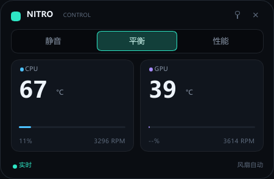

# Nitro Control

[English](README.en.md) | 简体中文

Acer Nitro / Predator 的轻量原生控制挂件。Slint + software renderer，LocalSystem broker，按需启动，无 WebView、无 Electron、无内核驱动。

## 为什么做这个

原版 NitroSense 3.1.3056 在本机 AN515-58 上：界面打开时约 144 MB 内存 + 90-95% 单核 CPU；关闭界面后后台仍常驻约 69 MB。

Nitro Control 保留原版的权限分层——特权后端是 Windows 服务，UI 是普通用户——但把 UI 换成 Slint 软件渲染的小挂件，并把服务改成按需启动、空闲自停。

## 实测

本机 AN515-58，i7-12650H，RTX 4050 Laptop，125% DPI：

| 组件 | 工作集 | 私有内存 |
|---|---:|---:|
| nitro-widget（Slint software） | 18.9 MB | 3.8 MB |
| nitro-broker（WMI + NVML） | 39 MB | 27 MB |
| 合计 | 约 58 MB | 约 31 MB |

服务空闲 5 分钟后自动停止；关闭挂件后不占后台内存。

## 当前功能

- 360x236 无边框、置顶、可拖动挂件
- 性能模式：静音 / 平衡 / 性能
- CPU：温度、负载、风扇 RPM
- GPU：温度、负载、风扇 RPM
- 非管理员 UI；服务按需启动
- 中文界面，中文字体使用系统字体

暂未实现：4 区 RGB、风扇曲线编辑器、托盘图标、GPU 超频、多机型配置。当前版本聚焦“看温度 + 切模式”。

## 架构

    nitro-widget.exe  (普通用户, Slint software)
            |
            |  \\.\pipe\nitro-control
            v
    NitroControlBroker  (Windows 服务, LocalSystem, start=demand)
            |
            v
    ACPI-WMI AcerGamingFunction + NVML + sysinfo

UI 启动时通过 SCM 拉起服务，服务空闲 5 分钟后自动停止。

## 安全

- 服务安装在 C:\Program Files\NitroControl；只有 SYSTEM/Administrators 可修改，Users 只能读/执行
- 管道 ACL 只允许 SYSTEM、Administrators、安装时记录的当前用户 SID
- 服务校验客户端完整路径必须是同目录的 nitro-widget.exe
- 只接受 telemetry 和 set_mode 两个命令；模式白名单 0/1/4/5/6
- 请求上限 4 KB、最多 8 个并发管道、set_mode 限流 300 ms、拒绝远程客户端
- 无任意程序/路径执行、无 shell、无网络监听
- 服务日志和配置在 C:\ProgramData\NitroControl，用户只读

## 下载与安装

从 Releases 下载：

    https://github.com/Isilsolme/nitro-control/releases/latest

安装器会：

1. 复制 nitro-broker.exe / nitro-widget.exe 到 C:\Program Files\NitroControl
2. 收紧目录 ACL
3. 记录当前用户 SID 到 C:\ProgramData\NitroControl\user.sid
4. 创建 LocalSystem 服务 NitroControlBroker（start=demand），并设置允许当前用户免 UAC 启动的服务 DACL
5. 创建开始菜单和桌面快捷方式；“登录时自动启动挂件”是可选项，默认不勾

安装器不会以管理员身份启动 UI。安装完成后，从开始菜单以普通用户启动 Nitro Control。

## 从源码构建

需要 Rust（MSVC 工具链）和 Windows 10/11 x64：

    cargo build --release

## 构建安装器

需要 NSIS。可以用 winget 安装，或使用 Tauri 自带的 NSIS：

    winget install NSIS.NSIS
    powershell -ExecutionPolicy Bypass -File installer\build.ps1

输出：

    dist\NitroControl-Setup-0.1.1.exe

GitHub Actions 会在 windows-latest 上用 chocolatey 安装 NSIS 并构建同一个安装器。

## 服务控制

    sc.exe query NitroControlBroker
    sc.exe start NitroControlBroker
    sc.exe stop NitroControlBroker

UI 会自动启动服务。服务无客户端 5 分钟后自停；下次打开 UI 再启动。

## 卸载

设置 > 应用 > Nitro Control，或运行：

    "C:\Program Files\NitroControl\uninstall.exe"

卸载会停止/删除服务，删除快捷方式、文件与 C:\ProgramData\NitroControl。

## 已知限制

- 目前只在 Acer Nitro AN515-58（BIOS V2.21）上实测；其他机型的 WMI 位域可能不同
- 安装器与二进制未签名，公开分发前建议代码签名，避免 SmartScreen
- 安装需要一次管理员权限
- 仅支持 Windows x64

## 目录

    core/       WMI、NVML、遥测线程
    broker/     Windows 服务、命名管道、安全校验
    widget/     Slint UI + 管道客户端
    installer/  NSIS 安装器
    .github/    GitHub Actions

日志：

    C:\ProgramData\NitroControl\broker.log
    C:\ProgramData\NitroControl\core.log

## 许可证

GPL-3.0。详见 LICENSE。

Slint 采用 GPL-3.0 或 royalty-free 双许可；本项目按 GPL-3.0 分发。
